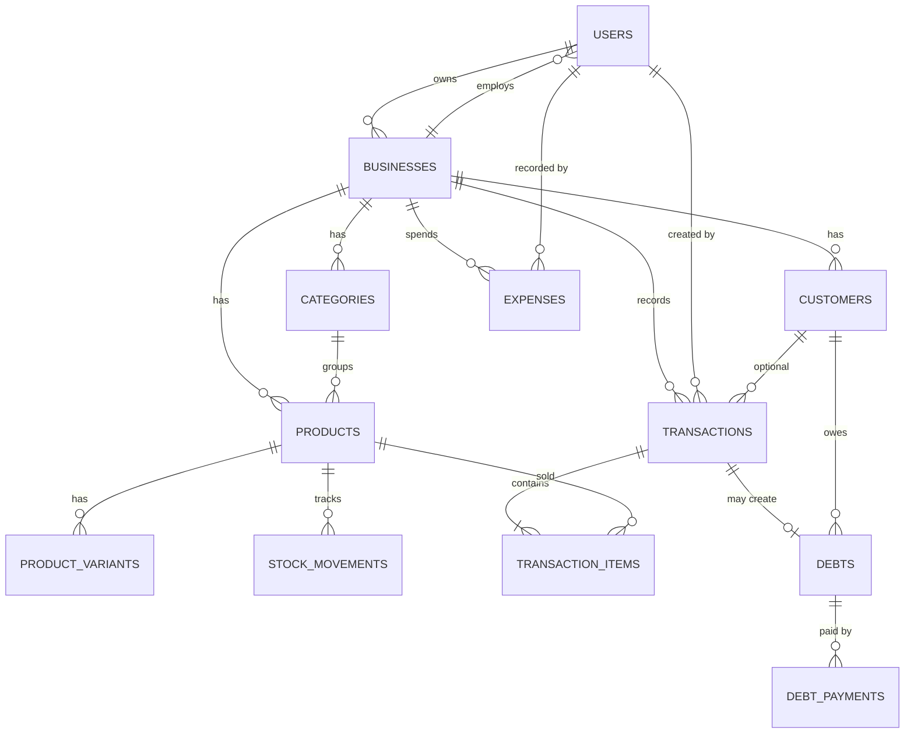

# WarungKu — Backend API (Multi-Tenant POS & Management UMKM)

> **Sistem Manajemen Usaha untuk UMKM:** Kasir (POS), Manajemen Stok Otomatis, Utang/Kasbon Pelanggan, Pengeluaran, dan Laporan Keuangan Dinamis dalam Satu Sistem Multi-Tenant.

---

## 📌 1. Identitas & Latar Belakang Sistem

**WarungKu** adalah platform backend API yang dirancang khusus untuk memfasilitasi kebutuhan operasional UMKM skala kecil dan menengah (1 pemilik + 1 sampai 3 pegawai). Sistem ini bersifat **multi-tenant** fleksibel: pemilik usaha dapat mendaftarkan bisnisnya sendiri (warung kopi, toko kelontong, katering, kios pakaian, dsb.), lalu mengelola kategori produk, satuan kuantitas (pcs, kg, cup, porsi), serta varian harga secara mandiri.

### Masalah Nyata yang Diselesaikan:
1. **Pencatatan Penjualan Rentan Hilang**: Menggantikan nota manual/kertas dengan pencatatan digital transaksi kasir atomik.
2. **Kebutaan Stok (*Stock Blindness*)**: Mengurangi stok secara otomatis saat checkout penjualan dan memperingatkan stok yang mendekati ambang batas minimum (*min_stock*).
3. **Kasbon/Utang Pelanggan Terlupakan**: Mencatat otomatis piutang pelanggan dari transaksi belum lunas beserta riwayat cicilan pelunasannya.
4. **Biaya Operasional Tidak Terpantau**: Rekap pengeluaran (belanja bahan, listrik, sewa, gaji) untuk mengkalkulasi laba kotor dan laba bersih riil.

---

## 🏛️ 2. Arsitektur Sistem (Go Clean Architecture)

Sistem dibangun menggunakan **Go (Golang)** dengan pola **Clean Architecture** sesuai standar modul perkuliahan:
* **`app/model/`**: Entitas bisnis dan DTO (Data Transfer Object) request/response bertipe kuat.
* **`app/repository/`**: Layer akses data (PostgreSQL `pgxpool`), transaksi atomik (`dbtx`), dan query SQL terisolasi per `business_id`.
* **`app/service/`**: Layer logika bisnis, validasi multi-tenant, dan handler HTTP Fiber (tanpa folder controller/handler terpisah).
* **`route/`**: Registrasi rute endpoint dan pengelompokan middleware.
* **`middleware/`**: Autentikasi JWT Bearer token, ekstraksi multi-tenant context (`business_id`), dan role-based access control (RBAC).
* **`migrations/`**: Script DDL migrasi SQL skema 12 tabel.

```
warungku/
├── app/
│   ├── model/             # Entitas & DTO Request/Response
│   │   ├── user.go
│   │   ├── business.go
│   │   ├── category.go
│   │   ├── product.go
│   │   ├── transaction.go
│   │   ├── debt.go
│   │   ├── expense.go
│   │   └── report.go
│   ├── repository/        # Data Access Layer (PostgreSQL)
│   │   ├── dbtx.go
│   │   └── user_repository.go
│   └── service/           # Business Logic & Endpoint Delivery
│       └── auth_service.go
├── config/                # Environment & Database Pool Loader
│   ├── config.go
│   └── database.go
├── helper/                # Standard Response, Custom Errors, JWT
│   ├── errors.go
│   ├── jwt.go
│   └── web_response.go
├── middleware/            # Auth Guard, Role Guard, Business Scope
│   └── auth_middleware.go
├── migrations/            # SQL DDL Database
│   └── 001_init_schema.sql
├── route/                 # Router Setup
│   └── route.go
├── .env.example
├── .gitignore
├── go.mod
├── go.sum
├── main.go                # Application Bootstrapper
└── README.md
```

---

## 🗄️ 3. Rancangan Database (12 Tabel Relasional)



---

## 🛡️ 4. Role & Hak Akses

| Role | Deskripsi | Hak Akses Utama |
|---|---|---|
| **`admin`** | Administrator Platform | Melihat daftar seluruh bisnis, statistik agregat platform, aktivasi/deaktivasi akun. |
| **`owner`** | Pemilik Usaha | Kelola usaha, produk, kategori, pegawai (kasir), stok, pengeluaran, utang, void transaksi, dan seluruh laporan finansial. |
| **`cashier`** | Pegawai / Kasir | Buat transaksi penjualan, lihat produk dan stok, catat pelunasan utang, dan lihat laporan ringkasan harian. |

---

## 🚀 5. Panduan Instalasi & Menjalankan

### Prasyarat:
* Go versi 1.22 atau lebih baru
* PostgreSQL 14+ aktif di `localhost:5432`

### Langkah Menjalankan:
1. **Clone Repository:**
   ```bash
   git clone https://github.com/alan-mmr/warungku.git
   cd warungku
   ```

2. **Setup Database:**
   Buat database di PostgreSQL:
   ```bash
   psql -U postgres -c "CREATE DATABASE warungku_db;"
   ```
   Eksekusi migrasi skema tabel:
   ```bash
   psql -U postgres -d warungku_db -f migrations/001_init_schema.sql
   ```

3. **Konfigurasi Environment:**
   Salin file template `.env.example` menjadi `.env`:
   ```bash
   cp .env.example .env
   ```
   Sesuaikan `DATABASE_URL` dengan user dan password PostgreSQL lokal Anda.

4. **Jalankan Aplikasi:**
   ```bash
   go run main.go
   ```
   Aplikasi akan menyala pada `http://localhost:3000`.

---

## 👥 6. Pembagian Modul & Alur Git Master (3 Anggota)

| Anggota Tim | Branch Fitur | Tanggung Jawab Modul |
|---|---|---|
| **Anggota 1 (Git Master)** | `main` & `feature/auth-employee` | Fondasi Clean Architecture, Auth JWT, Manajemen Usaha & Pegawai, Review & Merge Pull Request. |
| **Anggota 2** | `feature/catalog-stock` | Manajemen Kategori, Produk, Varian Harga, dan Pergerakan Stok (Stok Masuk & Opname). |
| **Anggota 3** | `feature/transaction-report` | Transaksi Kasir Atomik (Checkout potong stok), Manajemen Utang Pelanggan, dan Laporan Keuangan. |

---

## 📜 7. Lisensi
Hak Cipta © 2026 Tim Pengembang WarungKu. Dikembangkan untuk Praktikum Pemrograman Backend Lanjut.
